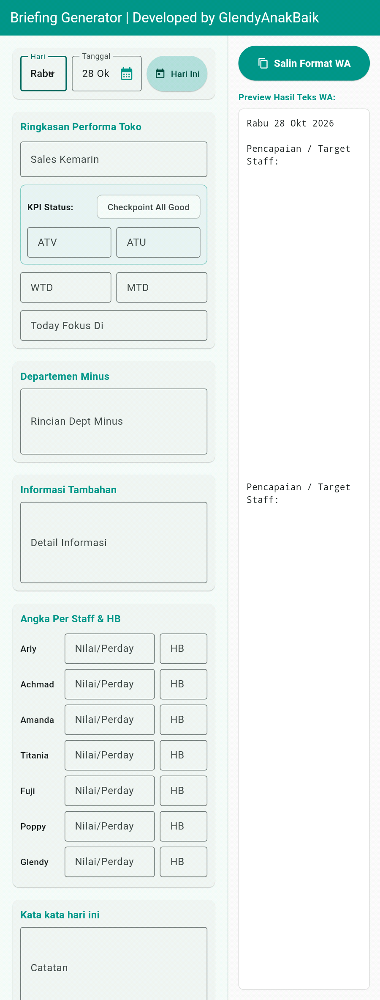
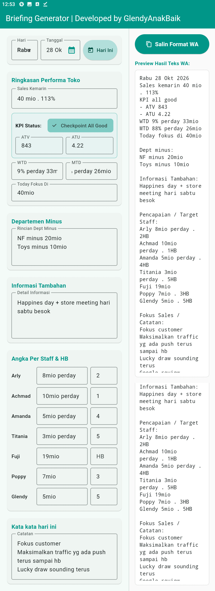

# Briefing Generator

Aplikasi Flutter untuk membantu menyusun briefing crew dengan format yang konsisten dan lebih cepat. Informasi briefing diisi melalui formulir, lalu hasilnya otomatis ditampilkan sebagai teks yang siap disalin dan dibagikan melalui WhatsApp.

## Latar Belakang

Sebelumnya, briefing crew dicatat secara manual. Cara tersebut membuat tata letak dan format pencatatan sering tidak konsisten serta menghabiskan waktu untuk mengetik ulang informasi. Aplikasi ini dibuat untuk menyederhanakan proses tersebut: crew cukup mengisi informasi pada kolom yang tersedia, kemudian aplikasi menyusun briefing dalam format yang rapi.

## Tampilan Aplikasi

### Template aplikasi

### Template setelah diisi

## Fitur

- Mengatur hari dan tanggal briefing, termasuk memilih tanggal melalui kalender atau mengisi tanggal hari ini.
- Mengisi ringkasan performa toko, seperti sales kemarin, status KPI, ATV, ATU, WTD, MTD, dan fokus hari ini.
- Mencatat departemen yang minus dan informasi tambahan.
- Mengisi pencapaian atau target per staf serta nilai House Brand (HB).
- Menambahkan fokus sales atau catatan briefing.
- Melihat pratinjau teks briefing yang diperbarui saat data diisi.
- Menyalin hasil dengan format siap dibagikan melalui WhatsApp.

## Teknologi

- [Flutter](https://flutter.dev/)
- Dart
- Material

## Cara Menggunakan

1. Pilih hari dan tanggal briefing.
2. Isi bagian performa toko, KPI, departemen, informasi tambahan, target staf, dan catatan sesuai kebutuhan.
3. Periksa hasil yang tampil pada bagian pratinjau.
4. Tekan **Salin Format WA** untuk menyalin teks briefing.
5. Tempelkan teks tersebut ke WhatsApp atau kanal komunikasi yang digunakan crew.